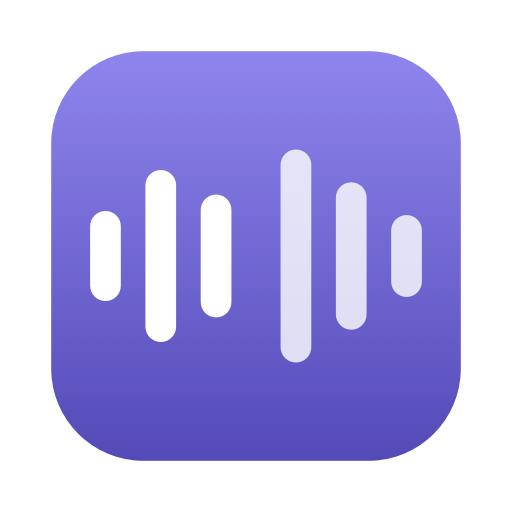
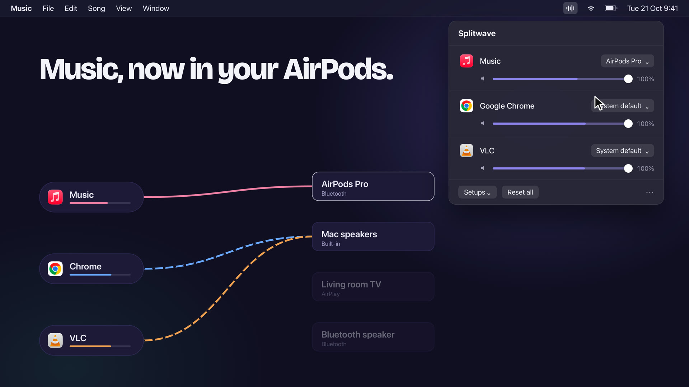

<p align="center"></p>

# Splitwave

Splitwave is a macOS menu-bar app that sends each app's sound to the output you choose: music
on your AirPods, the movie on the TV, a call on the speakers, all at once. It also gives every app
its own volume.

**[Download Splitwave](https://github.com/tsikatawill/splitwave/releases/latest/download/Splitwave.dmg)**
· [Website](https://tsikatawill.github.io/splitwave/) · macOS 14.2 or later, Apple silicon and Intel

<a href="https://tsikatawill.github.io/splitwave/demo.mp4"></a>

▶ [Watch the 30-second demo](https://tsikatawill.github.io/splitwave/demo.mp4)

## Features

- **An output per app.** Pick a device next to any app that's playing, or several at once under
  *Also play on*. Apps you leave alone keep using the system output.
- **A volume for every app**, with mute and a live level meter.
- **Setups.** Save every app's outputs and volume as "Desk" or "Movie night" and switch in one click,
  from Shortcuts (`splitwave://setup/Desk`) or from the command line.
- **Routes that come back.** Unplug the AirPods and the app falls back to the system output; reconnect
  them and the route returns on its own.
- **No driver.** Built on the audio taps in macOS 14.2, so there's nothing to install besides the app.

## Install

1. Download [Splitwave.dmg](https://github.com/tsikatawill/splitwave/releases/latest/download/Splitwave.dmg)
   and drag Splitwave into Applications.
2. Splitwave isn't notarized by Apple yet, so the first launch is blocked. Open **System Settings ›
   Privacy & Security**, scroll down and click **Open Anyway** next to Splitwave.
3. Allow **system audio recording** when asked. Splitwave needs it to move an app's sound; it only
   touches the apps you route and never records or saves anything.

## Command line

```sh
sudo mkdir -p /usr/local/bin
sudo ln -sf /Applications/Splitwave.app/Contents/MacOS/splitwave /usr/local/bin/splitwave

splitwave list                        # apps playing sound, and your outputs
splitwave route spotify airpods       # one app, one or more outputs (`default` follows the system)
splitwave volume chrome 30            # any app's volume; also `mute` / `unmute`
splitwave setup save Desk             # also: setup list | apply Desk | delete Desk
splitwave unroute spotify             # or: unroute --all
splitwave doctor                      # permission, app and saved routes at a glance
```

Names match loosely: `splitwave route vlc tv "bluetooth speaker"`.

## Good to know

- **Privacy:** everything runs on your Mac. No network access, accounts or analytics; audio goes
  straight from the app to your speakers and is never stored. A log of route changes is kept in
  `~/Library/Logs/Splitwave/`.
- **Browsers route as a whole**, because they play every tab through one process. To split two sites,
  use two browsers or save one as a Safari web app (File › Add to Dock).
- **Bluetooth delay:** when one app plays on several outputs, Bluetooth devices run 100–200 ms behind
  wired ones.
- Some copy-protected video plays silently once routed.

## Uninstall

Quit Splitwave from its menu, delete it from Applications, and optionally remove
`~/Library/Application Support/Splitwave` and `~/Library/Logs/Splitwave`.

## Contributing

Bug reports and pull requests are welcome. See [DEVELOPMENT.md](DEVELOPMENT.md) for building from
source, testing and releasing.

## License

[MIT](LICENSE)
